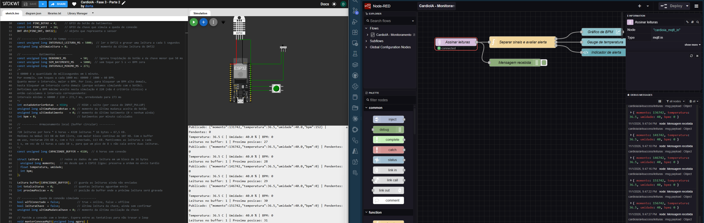
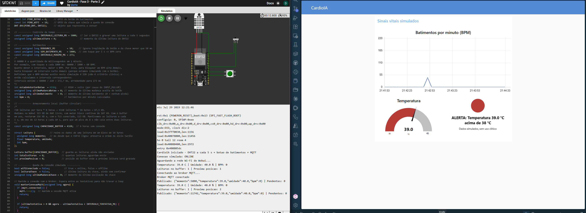
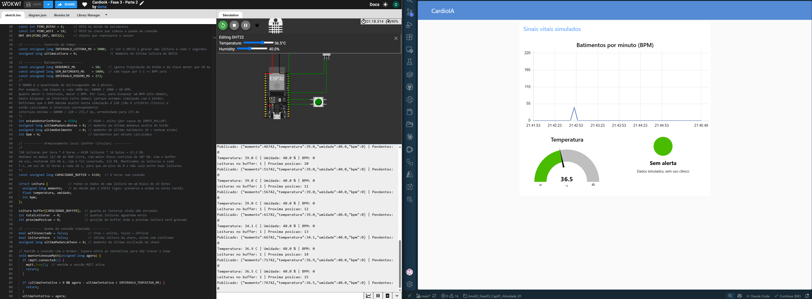
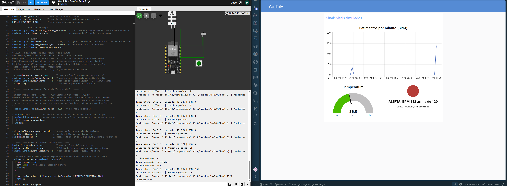

# Relatório da Parte 2 — Transmissão para nuvem e visualização (Fog/Cloud Computing)

**CardioIA — Fase 3: Monitoramento Contínuo – IoT na Saúde**
**Grupo AI4Success — Turma 2TIAOR**
Durval de Oliveira Dorta Junior (RM 567007) e Guilherme da Nobrega Gontijo (RM 562211)

**Código:** [src/parte2_cloud/](../src/parte2_cloud/)

Os dados deste trabalho são simulados, e o protótipo não foi validado para uso clínico.

## 1. Objetivo

Esta parte leva as leituras do ESP32 simulado no Wokwi até um dashboard. O dispositivo publica os dados em um broker MQTT na nuvem, e o Node-RED os recebe e exibe em tempo real, com alertas automáticos. A lógica de borda da Parte 1 foi mantida: as leituras continuam passando pelo buffer circular e só saem dele depois de publicadas.

## 2. Arquitetura

```text
ESP32 no Wokwi  →  HiveMQ Cloud  →  Node-RED  →  Dashboard
Borda (Edge)       Nuvem (broker)   Névoa (Fog)   Visualização
```

- **Borda:** o ESP32 captura os sinais, filtra artefatos e guarda as leituras sem conexão.
- **Nuvem:** o HiveMQ Cloud recebe as mensagens e as distribui aos assinantes.
- **Névoa:** o Node-RED roda em um computador local, interpreta cada mensagem e decide o que exibir e quando alertar.

O ESP32 e o Node-RED não se conhecem. Os dois falam apenas com o broker: um publica e o outro assina. Esse desacoplamento permite acrescentar novos assinantes sem alterar o dispositivo.

## 3. Fluxo de comunicação MQTT

### 3.1 Escolha do broker

O enunciado cita o HiveMQ Cloud como exemplo, e o Cap08 (p. 24) usa uma versão gratuita desse serviço, com TLS. Na data da implementação, a documentação da HiveMQ informava que novos clusters do plano gratuito Serverless não podiam mais ser criados. Por isso, usamos o plano Starter, um teste de 15 dias, na região de Frankfurt.

### 3.2 Conexão

| Parâmetro | Valor |
|---|---|
| Porta | 8883 (MQTT com TLS) |
| Protocolo | MQTT 3.1.1 |
| Autenticação | Usuário e senha criados no broker |
| Tópico | `cardioia/ai4success/leituras` |
| Qualidade de serviço (QoS) | 0 |
| Formato | JSON |

O ESP32 usa as bibliotecas `WiFi`, `WiFiClientSecure` e `PubSubClient`, as mesmas do exemplo do Cap08. No Wokwi, ele se conecta à rede virtual `Wokwi-GUEST`. As credenciais ficam fora do repositório: o `sketch.ino` publicado traz campos a preencher.

### 3.3 Publicação

Cada leitura é publicada como JSON, com um campo para cada dado guardado no buffer:

```json
{"momento":131742,"temperatura":36.5,"umidade":40.0,"bpm":152}
```

A publicação acontece uma leitura por vez, com no máximo 10 mensagens por segundo, da mais antiga para a mais nova. A posição no buffer só é liberada se a publicação for aceita. Se falhar, a leitura continua guardada.

A conexão com o broker é refeita, quando necessário, a cada 5 s, sem repetição contínua. A chave deslizante da Parte 1 continua simulando a queda: em OFFLINE, a coleta segue, mas nada é publicado.

## 4. Configuração do dashboard

O fluxo exportado está em [flow_nodered.json](../src/parte2_cloud/flow_nodered.json), sem endereço nem credenciais. Depois de importado, é preciso informar o broker no próprio Node-RED. Usamos o Node-RED 5.0.9 e o pacote `node-red-dashboard` 3.6.6.



O fluxo tem estes nós:

| Nó | Função |
|---|---|
| Assinar leituras (`mqtt in`) | Assina o tópico e interpreta o JSON |
| Separar sinais e avaliar alerta (`function`) | Valida a mensagem, separa os sinais e aplica os limites |
| Gráfico de BPM (`ui_chart`) | Mostra o BPM dos últimos 10 minutos |
| Gauge de temperatura (`ui_gauge`) | Mostra a temperatura entre 30 e 45 °C |
| Indicador de alerta (`ui_template`) | Mostra um LED virtual, verde ou vermelho, e o motivo do alerta |
| Mensagem recebida (`debug`) | Mostra as mensagens no painel de depuração |

O alerta dispara acima de **120 BPM** ou de **38 °C**, valores tomados dos exemplos do enunciado. Eles valem para esta simulação e não são critérios clínicos. Esse limite é diferente do filtro de 220 BPM da Parte 1: o filtro descarta o que não parece um dado real, e o alerta mantém o dado e sinaliza que ele merece atenção.

## 5. Testes

| Teste | Entrada | Resultado |
|---|---|---|
| Publicação | Leituras a cada 5 s | Mensagens recebidas no Node-RED |
| Alerta de temperatura | 39,0 °C | Indicador vermelho, com o motivo |
| Sem alerta | 36,5 °C, BPM até 120 | Indicador verde e gauge em 36,5 |
| Alerta de BPM | Toques rápidos, 152 BPM | Indicador vermelho, com o motivo, e gráfico subindo |
| Queda simulada | 3 leituras em OFFLINE | Publicadas em ordem ao voltar: 26655, 31655 e 36655 ms |
| Lógica do alerta | 7 casos, com limites e mensagens inválidas | Resultados corretos |







Com o TLS conectado, a RAM livre medida no Wokwi caiu de 256 KB para 113 KB, e o maior bloco contínuo ficou em 59 KB. Essa folga confirmou a decisão de manter o buffer de 4.320 leituras definido na Parte 1.

## 6. Segurança e boas práticas

- **Criptografia e autenticação:** a comunicação usa TLS, e o broker exige usuário e senha.
- **Certificado:** o ESP32 usa `setInsecure()`, como no Cap08, então criptografa a conexão, mas não verifica o certificado do broker. Um produto real precisaria dessa verificação.
- **Credenciais:** a senha não fica no repositório. Usamos um usuário exclusivo da atividade.
- **LGPD:** o broker fica em Frankfurt, fora do Brasil. Aqui os dados são simulados, mas dados reais de pacientes são sensíveis e exigiriam avaliar a transferência internacional, o controle de acesso e a retenção.
- **Acesso local:** o Node-RED foi limitado ao próprio computador (`127.0.0.1`), porque roda sem senha no editor.

## 7. Limitações e melhorias futuras

- **Horário no gráfico:** o eixo usa a hora de chegada no Node-RED. Leituras enviadas depois de uma queda aparecem juntas, embora o campo `momento` preserve a ordem original.
- **Alerta atrasado:** durante a sincronização, o indicador reflete a última leitura recebida, que pode ser antiga.
- **Entrega:** com QoS 0, não há confirmação do broker, e uma leitura aceita pelo cliente pode se perder. Usar QoS 1 reduziria esse risco.
- **Bloqueio:** a conexão com TLS deixa o `loop()` parado por cerca de 2 s, e toques nesse intervalo não são contados.
- **Reconexão:** nos testes, a sessão não caiu durante o período offline, então a reconexão depois de uma queda real não foi exercitada.
- **Disponibilidade:** o plano Starter é um teste de 15 dias. Depois disso, o cluster é removido, e o projeto precisa de um novo broker para voltar a publicar.
- **Histórico:** o Node-RED mostra os dados, mas não os guarda. O Cap08 indica o InfluxDB e o Grafana Cloud para isso, itens opcionais não implementados aqui.

## 8. Referências

- FIAP. [Enunciado da atividade da Fase 3](Enunciado.md).
- FIAP. Fase 3, Cap08 — Cloud Computing como Pilar da IoT Moderna, p. 21-25.
- HiveMQ. [Getting Started with HiveMQ Cloud](https://docs.hivemq.com/hivemq-cloud/quick-start-guide.html).
